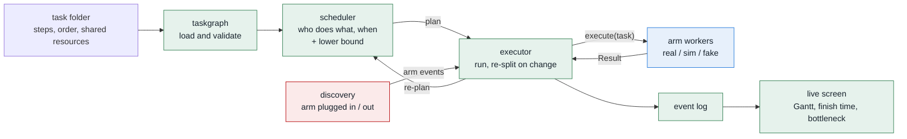

# HFTeamA: plug and produce

Finish a batch of work faster by plugging in more SO-101 arms. When an arm is added, removed or
fails, the orchestrator re-splits the remaining work live and shows the new predicted finish time
and what limits further speed-up. Task-agnostic: any job that splits into steps, order and shared
zones (see `tasks/README.md`). Plan and teams: `docs/plan.md`. Who is doing what right now: [`STATUS.md`](STATUS.md). Visual map: `docs/README.md`.

## How it works



Green: Operations (#21). Blue: Action (#20). Red: Hardware (#19). Full plan: [`docs/plan.md`](docs/plan.md).
More detail (what happens when an arm is plugged in, speed-up limits, who builds what):
[`docs/README.md`](docs/README.md), and the one-page map [`docs/map.html`](docs/map.html) (download and open in a browser).

## Requirements

- Python 3.10+

## Setup

```bash
python -m venv .venv
source .venv/bin/activate
pip install -e ".[dev,sched,view]"   # add sim for MuJoCo
```

## Usage

```bash
hfteama
# or
python -m hfteama
```

### Real arms (Hardware, #19)

Calibrate, teleoperate and record with leader/follower pairs (needs LeRobot, see the guide):

```bash
hfteama pairs                          # pairs in configs/teleop_pairs.json and which arms are connected
hfteama --pair hacklab calibrate leader
hfteama --pair rakesh teleop
hfteama --pair rakesh record --episodes 5 --task "..."
```

Guide: [`docs/hardware/so101_setup.md`](docs/hardware/so101_setup.md).
Calibrations: [`configs/calibration/`](configs/calibration/README.md).

## Development

```bash
pytest          # run tests
ruff check .    # lint
ruff format .   # format
```

## Project structure

```
.
├── src/hfteama/
│   ├── taskgraph/   # task graph JSON: loader, validator (frozen interface)
│   ├── scheduler/   # HEFT, CP-SAT, plan checker, lower bound
│   ├── executor/    # dispatch, resource locks, re-plan on arm added / removed / failed
│   ├── arms/        # arm contract, skill registry, kinematics, real / sim / fake arms
│   ├── view/        # live Gantt, predicted finish, binding limit, scaling plot
│   └── events.py    # event log (frozen interface)
├── tasks/           # one folder per task: graph, poses, extra skills
├── configs/         # arm registry template
├── scripts/         # benchmarks, tools
├── research/        # background report and notes
├── docs/            # plan.md (main plan), map.html + diagram in docs/README.md
├── tests/           # run by CI on every push (.github/workflows/ci.yml)
└── pyproject.toml
```
