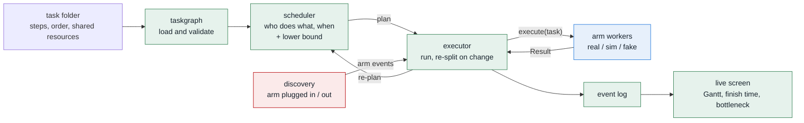

# HFTeamA: plug and produce

Finish a batch of work faster by plugging in more SO-101 arms. When an arm is added, removed or
fails, the orchestrator re-splits the remaining work live and shows the new predicted finish time
and what limits further speed-up. Task-agnostic: any job that splits into steps, order and shared
zones (see `tasks/README.md`). Plan and teams: `docs/plan.md`. Who is doing what right now: [`STATUS.md`](STATUS.md). Visual map: `docs/README.md`.

## How it works



Green: Operations (#21). Blue: Action (#20). Red: Hardware (#19). Full plan: [`docs/plan.md`](docs/plan.md).
More detail (what happens when an arm is plugged in, speed-up limits, who builds what):
[`docs/README.md`](docs/README.md), and the one-page map at https://termvato.github.io/HFTeamA/map.html

## Requirements

- Python 3.10+

## Setup

```bash
python -m venv .venv
source .venv/bin/activate
pip install -e ".[dev,sched,view]"   # add sim for MuJoCo
```

## Usage

### Run the demo (Operations, #21)

```bash
pip install -e ".[dev,sched,view,arms]"
python -m hfteama.demo --backend fake --plugged rakesh_follower   # no hardware needed
```

Open http://127.0.0.1:8050 and press **Go**. The screen shows the estimate (with a what-if for more
arms), then the countdown, the plan against what really happened, and in words what limits the
speed. "Arm controls" on the page plugs in the next arm, removes one (slow stop) or pulls its
cable; with real arms the same happens when a follower's USB is plugged in or out
([`src/hfteama/discovery.py`](src/hfteama/discovery.py)).

| Option | Meaning |
|---|---|
| `--backend fake` | arms that only wait (development, tests, the screen) |
| `--backend sim` / `real` | Action's skill worker on MuJoCo or on the real SO-101s (needs Action's arm code from `action-arm-skills`; `real` moves arms: a person must be at the rig) |
| `--task FILE` | the batch, e.g. `tasks/sort/sort12.json` |
| `--planner module:function` | batch from a planner instead (the camera + VLM pipeline) |
| `--verifier module:function` | camera check after each place step |
| `--plugged a,b` | arms present at start; `--watch` / `--no-watch` turns USB detection on or off |

Other tools: `python scripts/scaling_benchmark.py` (finish time against number of arms),
`python scripts/bench_planners.py` (planner speed), `python scripts/real_table_plan.py` (top camera
to plan, dry run), `scripts/isaac/` (Isaac Sim scene of the arms).

### Command-line tool

```bash
hfteama            # version; `hfteama --help` lists the hardware commands
```

### Real arms, step by step (Hardware, #19)

From a fresh computer to a recorded dataset. Everything below runs from the repo root.

**What we have.** Two leader/follower pairs of SO-101 arms, **already calibrated**; the
calibration files are committed in [`configs/calibration/`](configs/calibration/README.md).
**Do not calibrate them again.**

| Pair | Follower (USB serial) | Leader (USB serial) | Camera |
|---|---|---|---|
| `rakesh` (default) | `rakesh_follower` (`5B79014975`) | `rakesh_leader` (`5B8E115290`) | `wrist` (Sonix USB2.0_CAM1) |
| `hacklab` | `vato_follower` (`5A7A015861`) | `hacklab_leader` (`5A7A015820`) | `wrist` (Autodarts DIY Cam) |

Pairs, cameras and recording settings live in [`configs/teleop_pairs.json`](configs/teleop_pairs.json).

#### Step 1. Install (once per computer)

```bash
git clone https://github.com/termvato/HFTeamA.git && cd HFTeamA
git switch hardware && git pull

uv venv --python 3.13 .venv && source .venv/bin/activate          # LeRobot needs Python 3.12+
uv pip install -e ".[dev]" "lerobot[feetech,core-scripts]>=0.7"     # or the same with pip

sudo usermod -aG dialout $USER     # access to the arms' serial ports; then log out and back in
hf auth login                      # optional: only to push datasets to the Hugging Face Hub
```

Already have a venv with LeRobot? You still need `uv pip install -e ".[dev]"` inside this
repo, or you get `hfteama: command not found`.

#### Step 2. Connect and check (every time)

1. Plug in every arm by USB and **switch on each follower's 12 V supply**.
2. Plug in the wrist cameras (spread them over different USB ports, or use a powered hub).
3. Check:

```bash
source .venv/bin/activate
hfteama pairs
```

Every arm you need must say `connected at /dev/ttyACM*`. The `/dev/ttyACM*` numbers change
each time you plug in; that's fine: `hfteama` finds each arm by its USB serial and each
camera by its `/dev/v4l/by-id/` name, so you never set ports by hand. "Not connected"
means the USB cable is out or (follower) the 12 V supply is off. Keep each servo board on
its own arm: the serial belongs to the board, not the arm.

To see a pair's cameras: `hfteama --pair rakesh camera` (black image = lens covered).

#### Step 3. Teleoperate one pair

```bash
hfteama --pair rakesh teleop               # or --pair hacklab; add --cameras to see them in Rerun
```

Put the leader in roughly the follower's pose first (the follower jumps to the leader's
pose), move slowly at first, stop with `Ctrl+C`. If the follower moves erratically,
check its power supply first.

**If LeRobot asks** `Press ENTER to use provided calibration file associated with the id ...`:

| id in the message | What to do |
|---|---|
| `rakesh_leader` | Press **ENTER**. Expected once per arm: it writes the base adjustment from the file into the leader. |
| anything else | Don't press anything; stop with `Ctrl+C` and ask the Hardware team. |

Never type `c`: it starts a new calibration and overwrites the one that works. If it
starts calibrating without asking (it shows the "middle of the range" diagram), it did
not find the files: stop with `Ctrl+C` and make sure you run `hfteama` (not
`lerobot-teleoperate` by hand) on the `hardware` branch.

#### Step 4. Teleoperate both pairs at once

Two ways, depending on what you want to record:

| | **A. Pairs in parallel** | **B. Bimanual** |
|---|---|---|
| Use it when | the arms do independent work (plug and produce) | the two arms do one task together (e.g. a handoff) |
| What runs | one LeRobot process per pair | one LeRobot process, one two-arm robot (`bi_so_follower` / `bi_so_leader`) |
| Dataset | one per pair | one with both arms (12 joints, cameras `left_wrist`, `right_wrist`) |
| Command | `hfteama --pair rakesh,hacklab teleop --cameras` | `hfteama bimanual teleop --cameras` |

- **A** prefixes each pair's output with its name and hides LeRobot's per-loop status
  lines; `Ctrl+C` stops both. It first checks, read-only, that every arm's calibration
  matches its servos; if one doesn't, it stops and asks you to run that pair alone once
  (Step 3) to answer LeRobot's prompt. One terminal per pair also works.
- **B** uses the `bimanual` section of `configs/teleop_pairs.json`: left = `rakesh`,
  right = `hacklab`, as seen by the operator. **Each leader must stay with its own
  follower** (the calibrations are matched per pair); to swap sides, swap whole pairs
  there. LeRobot wants the calibrations as `hfteam_bi_left/right.json`; `hfteama` links
  them to the committed files under `~/.cache/hfteama/bimanual/`.

Both stream to the same Rerun window (pick a recording in its left panel).

#### Step 5. Record a dataset

```bash
# first, a quick test: 1 episode of 10 s into a throwaway dataset
hfteama bimanual record --episodes 1 --episode-time 10 --reset-time 2 --task "test" \
    --repo-id diegoloayza789/hfteam_bimanual_test

# then the real thing (describe the task in --task: a learned policy uses it as its instruction)
hfteama bimanual record --episodes 10 --task "Hand the cube from the left arm to the right arm"
hfteama --pair rakesh,hacklab record --episodes 10 --task "..."      # A: one dataset per pair
hfteama --pair rakesh record --episodes 10 --task "..."              # a single pair
```

Each episode: **record** (do the task with the leader) → **reset** (put the objects back)
→ next episode. Keys: `→` ends the episode early, `←` discards it and records it again,
`Esc` stops and saves. Defaults: 10 episodes, 60 s each, 30 s reset, 30 fps; change them
with `--episodes`, `--episode-time`, `--reset-time`.

| Mode | Dataset (`repo_id`) |
|---|---|
| `rakesh` | `diegoloayza789/hfteam_rakesh_so101` |
| `hacklab` | `diegoloayza789/hfteam_hacklab_so101` |
| bimanual | `diegoloayza789/hfteam_bimanual_so101` |

**Each session creates a new dataset** `<repo_id>_<date>_<time>` under
`~/.cache/huggingface/lerobot/` (LeRobot 0.7 adds the stamp so nothing is overwritten).
To add episodes to a session, pass its full name:

```bash
ls ~/.cache/huggingface/lerobot/diegoloayza789/
hfteama bimanual record --resume --episodes 5 --task "..." \
    --repo-id diegoloayza789/hfteam_bimanual_so101_20261121_152406
```

Datasets stay local; to upload, run `hf auth login` and set `"push_to_hub": true` in
`configs/teleop_pairs.json`. With A (parallel) on a normal desktop (X11), LeRobot reads
the keyboard globally, so **a key press goes to both recordings**; record one pair at a
time if each needs its own control.

Tested on 21 Nov: `hfteama bimanual record` gave 1 episode, 240 frames at 29.9 Hz,
12 joints (`left_*`, `right_*`) and both wrist videos.

#### Command reference

| Command | What it does |
|---|---|
| `hfteama pairs` | Pairs, which arms are connected and on which port, cameras |
| `hfteama --pair P camera [names]` | Live view of a pair's cameras in Rerun |
| `hfteama --pair P teleop [--cameras]` | Teleoperate one pair |
| `hfteama --pair P1,P2 teleop [--cameras]` | Teleoperate several pairs in parallel |
| `hfteama bimanual teleop [--cameras]` | Teleoperate both pairs as one two-arm robot |
| `hfteama [--pair P \| --pair P1,P2 \| bimanual] record [--episodes N] [--task T] [--episode-time S] [--reset-time S] [--repo-id R] [--resume]` | Record a dataset |
| `hfteama --pair P calibrate follower\|leader` | Calibrate an arm (new arms only) |
| `hfteama --pair P setup-motors follower\|leader` | Set motor IDs on a new arm |
| `hfteama find-port`, `hfteama find-cameras` | Find a new arm's port, list cameras |
| `hfteama -n ...` | Print the LeRobot command without running it |

Adding a new arm or pair, cameras and troubleshooting:
[`docs/hardware/so101_setup.md`](docs/hardware/so101_setup.md).

## Development

```bash
pytest          # run tests
ruff check .    # lint
ruff format .   # format
```

## Project structure

```
.
├── src/hfteama/
│   ├── taskgraph/   # task graph JSON: loader, validator (frozen interface)
│   ├── scheduler/   # HEFT, CP-SAT, plan checker, lower bound
│   ├── executor/    # dispatch, resource locks, re-plan on arm added / removed / failed
│   ├── arms/        # arm contract, skill registry, kinematics, real / sim / fake arms
│   ├── view/        # live Gantt, predicted finish, binding limit, scaling plot
│   └── events.py    # event log (frozen interface)
├── tasks/           # one folder per task: graph, poses, extra skills
├── configs/         # arm registry template
├── scripts/         # benchmarks, tools
├── research/        # background report and notes
├── docs/            # plan.md (main plan), map.html + diagram in docs/README.md
├── tests/           # run by CI on every push (.github/workflows/ci.yml)
└── pyproject.toml
```
