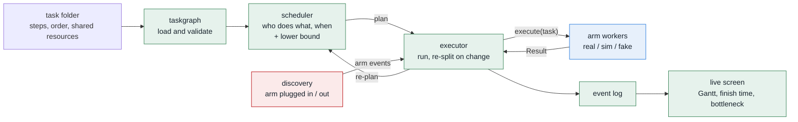

# HFTeamA: plug and produce

Finish a batch of work faster by plugging in more SO-101 arms. When an arm is added, removed or
fails, the orchestrator re-splits the remaining work live and shows the new predicted finish time
and what limits further speed-up. Task-agnostic: any job that splits into steps, order and shared
zones (see `tasks/README.md`). Plan and teams: `docs/plan.md`. Visual map: `docs/README.md`.

## How it works



Green: Operations (#21). Blue: Action (#20). Red: Hardware (#19). Full plan: [`docs/plan.md`](docs/plan.md).
More detail (what happens when an arm is plugged in, speed-up limits, who builds what):
[`docs/README.md`](docs/README.md), and the one-page map [`docs/map.html`](docs/map.html) (download and open in a browser).

## Requirements

- Python 3.10+

## Setup

```bash
python -m venv .venv
source .venv/bin/activate
pip install -e ".[dev,sched,view]"   # add sim for MuJoCo
```

## Usage

```bash
hfteama
# or
python -m hfteama
```

### Real arms: teleoperate a pair (Hardware, #19)

All arms are already calibrated; the calibration files are in the repo
([`configs/calibration/`](configs/calibration/README.md)). **Do not calibrate them again.**

**1. Once per computer**, from the repo root on the `hardware` branch:

```bash
git fetch && git switch hardware && git pull
uv venv --python 3.13 .venv && source .venv/bin/activate      # LeRobot needs Python 3.12+
uv pip install -e ".[dev]" "lerobot[feetech,core-scripts]>=0.7"
```

If you already have a venv with LeRobot, you still need `uv pip install -e ".[dev]"`
(or `pip install -e ".[dev]"`) inside this repo, or `hfteama: command not found`.

**2. Every time:** plug in both arms by USB and switch on the follower's 12 V supply, then:

```bash
source .venv/bin/activate
hfteama pairs                     # both arms of your pair must say "connected at /dev/ttyACM*"
hfteama --pair rakesh teleop      # or: --pair hacklab
```

Put the leader in roughly the follower's pose before starting (the follower jumps to the
leader's pose), move slowly at first, stop with `Ctrl+C`.

**If LeRobot asks** `Press ENTER to use provided calibration file associated with the id ...`:

| id in the message | What to do |
|---|---|
| `rakesh_leader` | Press **ENTER**. Expected once: it writes the base adjustment from the file into the leader. |
| anything else | Don't press anything; stop with `Ctrl+C` and ask the Hardware team. |

Never type `c`: it starts a new calibration and overwrites the one that works.

If it starts calibrating without asking (it shows the "middle of the range" diagram),
it did not find the files: stop with `Ctrl+C` and make sure you ran it with `hfteama` (not
`lerobot-teleoperate` by hand) on the `hardware` branch. `hfteama -n --pair rakesh teleop`
prints the exact LeRobot command; it must contain `--robot.calibration_dir=.../configs/calibration/...`.

| Pair | Follower (USB serial) | Leader (USB serial) | Cameras |
|---|---|---|---|
| `rakesh` (default) | `rakesh_follower` (`5B79014975`) | `rakesh_leader` (`5B8E115290`) | `wrist` |
| `hacklab` | `vato_follower` (`5A7A015861`) | `hacklab_leader` (`5A7A015820`) | `wrist` |

**Both pairs at once, with cameras:** one terminal per pair (each arm is its own USB bus).
Both stream to the same Rerun window; pick each pair's recording in Rerun's left panel.

```bash
hfteama --pair rakesh teleop --cameras     # terminal 1
hfteama --pair hacklab teleop --cameras    # terminal 2
```

Other commands: `hfteama --pair rakesh
camera`, `hfteama --pair rakesh record --episodes 5 --task "..."`.
Calibrating a new arm, cameras, recording and troubleshooting:
[`docs/hardware/so101_setup.md`](docs/hardware/so101_setup.md).

## Development

```bash
pytest          # run tests
ruff check .    # lint
ruff format .   # format
```

## Project structure

```
.
├── src/hfteama/
│   ├── taskgraph/   # task graph JSON: loader, validator (frozen interface)
│   ├── scheduler/   # HEFT, CP-SAT, plan checker, lower bound
│   ├── executor/    # dispatch, resource locks, re-plan on arm added / removed / failed
│   ├── arms/        # arm contract, skill registry, kinematics, real / sim / fake arms
│   ├── view/        # live Gantt, predicted finish, binding limit, scaling plot
│   └── events.py    # event log (frozen interface)
├── tasks/           # one folder per task: graph, poses, extra skills
├── configs/         # arm registry template
├── scripts/         # benchmarks, tools
├── research/        # background report and notes
├── docs/            # plan.md (main plan), map.html + diagram in docs/README.md
├── tests/           # run by CI on every push (.github/workflows/ci.yml)
└── pyproject.toml
```
