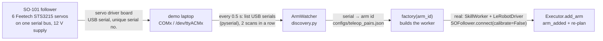
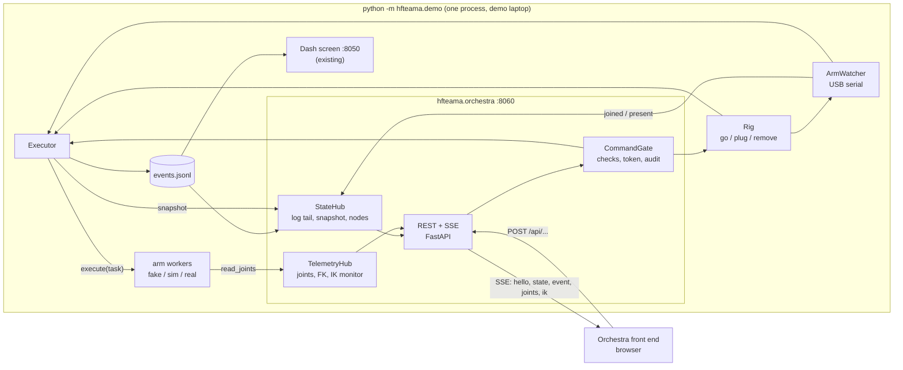
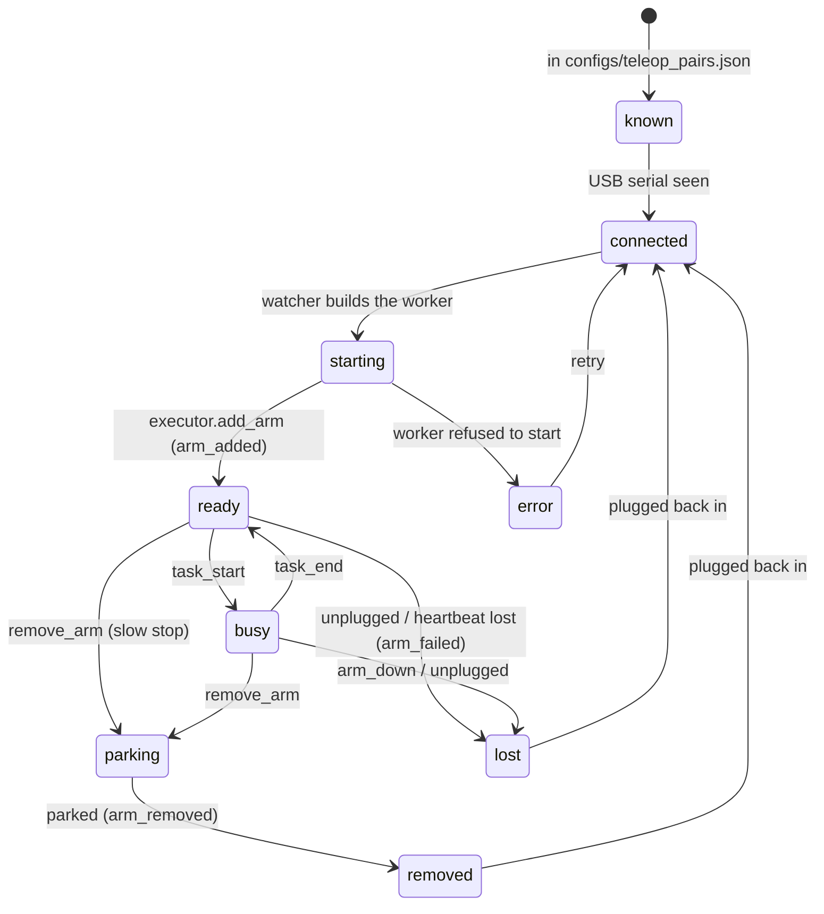

# Orchestra: operator dashboard for the orchestrator

Branch: `frontEndDash` (from `orchestrator` at `a7f6c97`). Started Sat 21 Nov 2026. Issue: to open
under Operations (#21).

Setting up the laptop with robots on USB: [`HANDOFF_DASHBOARD_USB.md`](HANDOFF_DASHBOARD_USB.md).

Orchestra is a browser dashboard for the plug-and-produce stack. It shows, live:

- how many arm nodes the stack knows, how many are plugged in, and how many have joined the run;
- each arm's state, current step, held part, heartbeat, joint angles, and where IK is sending it;
- the run: plan against actual, countdown, what limits the speed-up, and every event;
- controls: Go, pause, plug in, slow-stop, remove, stop all, and an IK preview that never moves an arm.

It reads the orchestrator; it does not replace it. The executor, scheduler, discovery and Action's
arm workers stay as they are. Orchestra adds a small API inside the demo process and a front end.
The current Dash screen (`hfteama.view`) keeps working on port 8050 until Orchestra covers the demo.

---

## 1. What already exists (what Orchestra reads)

| What | Where | What Orchestra uses from it |
|---|---|---|
| Event log (frozen interface) | `src/hfteama/events.py`, `runs/<time>/events.jsonl` | `plan`, `task_start`, `task_end`, `arm_added`, `arm_removed`, `arm_failed`, `replan` (reason, makespan, lower bound, binding, what-if, blocked, done/total) |
| Screen model | `src/hfteama/view/state.py` (`build(events) -> Screen`) | Phase, countdown, plan/actual bars, limit in words, feed. Pure functions, written to be reused by any front end |
| Executor | `src/hfteama/executor/executor.py` | `snapshot()` (active arms, parking, per-task status, busy, held, plan version, predicted finish, binding, blocked); `start`, `add_arm`, `remove_arm(abort)`, `arm_lost`, `update_graph`, `estimate` |
| Arm contract (frozen interface) | `src/hfteama/arms/base.py` | `ArmState` (`starting`, `ready`, `busy`, `parking`, `down`), `heartbeat()`, `backend` |
| Plug-in detection | `src/hfteama/discovery.py` | `ArmWatcher.joined()`, `plug`, `unplug`, `forget`; USB serial to arm id from `configs/teleop_pairs.json` |
| Demo runner and controls | `src/hfteama/demo.py` (`Rig`) | `go`, `add`, `remove`, `down`, `fail`, `arm_ids`; builds the executor, watcher and workers |
| Joint stream | `src/hfteama/view/joint_stream.py` | One reader per arm (`driver.read_joints`), already wired for sim arms in `action_factory` |
| Arm positions and reach | `src/hfteama/registry/arms.py`, `configs/real_arms.json`, `configs/hacklab_table.json` | Base pose and yaw per arm, `SO101_REACH` (r 0.14 to 0.42 m from the pan axis, hip ±110°), bowl, markers |
| IK and FK (Action, `action-arm-skills`) | `arms/ik.py` (`Kinematics`, `ArmBase`, `IKResult`), `arms/model.py`, vendored MJCF + STL meshes in `arms/assets/so101/` | Same solver the sim and real arms use: damped least squares on the MuJoCo Jacobian, tool pulled toward straight down, `ok` within 2 mm |
| Skills (Action) | `arms/generic_skills.py` | Waypoints of a step: approach (+0.08 m), grasp (+0.0 m), lift (+0.10 m), optional `carry` pose |
| Real driver (Action) | `arms/real.py` (`LeRobotDriver`) | `read_joints`, `alive`; stop latches and holds the last commanded pose; `park` is a slow move then torque off |

### How a robot connects to the stack



1. **Cable.** Each follower's servos are daisy-chained on one Feetech serial bus. The servo driver
   board turns that into a USB serial device with its own serial number (`5B79014975` =
   `rakesh_follower`, `5A7A015861` = `vato_follower`). The 12 V supply powers the servos; USB
   carries only data. The serial number belongs to the board, not the arm, so each board stays on
   its arm.
2. **Seen.** `ArmWatcher` lists the connected USB serial devices every 0.5 s. A known serial that
   appears in two scans in a row is "plugged in"; one missing for two scans is "unplugged". The
   port name (`COM5`, `/dev/ttyACM0`) can change on every plug-in and is never configured by hand.
3. **Joined.** The watcher calls the factory for that arm id. On `--backend real` this is Action's
   `SkillWorker` over `LeRobotDriver`: LeRobot's `SOFollower` on the found port, with the committed
   calibration, `connect(calibrate=False)`. If that works, `Executor.add_arm(worker)` writes
   `arm_added` and the work is re-split. If it fails, the error is logged and the arm is not joined.
4. **Alive.** While joined, the driver's `alive()` is the time of the last good bus traffic (an idle
   arm is polled after 0.5 s). The executor drops an arm whose heartbeat is older than 1.5 s, and
   drops it at once when the watcher sees the cable go.
5. **Commands.** Moves are sent over the same bus by `send_action`, at most 0.05 rad per joint per
   30 Hz tick, all through one bus lock.

`--backend sim` replaces steps 1 to 2 with MuJoCo arms plugged in from the screen; `--backend fake`
uses arms that only wait. The browser never talks to an arm: it talks only to the Orchestra API in
the same process. The real path (step 3) lives on `action-arm-skills` and has not been run on a
real arm yet. The Windows laptop is untested (Blockers #3).

Two facts shape the design:

1. **Everything runs in one process** on the demo laptop (decided 17:55, Blockers #3 in
   `OPERATIONS_STATUS.md`). The executor, watcher and workers are Python objects in
   `python -m hfteama.demo`. So the API lives in that process, next to Dash, and calls them directly.
   No separate service, no IPC.
2. **The event log is the record; the snapshot is the present.** The log says what happened (and
   lets a browser that reconnects catch up). The executor snapshot and worker states say what is true
   right now (who is busy, who holds a part, heartbeat age). Orchestra needs both.

---

## 2. Research summary

What we looked at and what we took from it. Sources at the end.

| Topic | Finding | Decision for Orchestra |
|---|---|---|
| Existing robot dashboards | Open-RMF's `rmf-web`: robots push state to an API server over WebSocket, the dashboard is a separate front end on that server's REST + push API. Foxglove: a WebSocket server in the robot process, the app subscribes to topics; LeRobot can already stream SO-100/101 joints to it. No product does live re-splitting across arms in one cell (`research/notes/industry_products.md`), so the dashboard has to be ours | Same shape as rmf-web: an API server in the orchestrator process, a front end that only talks to it. Foxglove stays a debugging tool for Action and Hardware, not the operator screen |
| Push channel | For screens that mostly display, Server-Sent Events (SSE) are simpler than WebSocket: plain HTTP, browser reconnects by itself, `Last-Event-ID` resumes a stream. WebSocket pays off when the browser streams input back (teleop, jogging) | SSE for everything the server pushes; plain REST `POST` for commands. Commands are rare, must be confirmed and logged, and are easier to test as requests. Move to WebSocket only if live jogging is added (section 9, M6) |
| 3D arm in the browser | `urdf-loader` (three.js) loads the SO-101 URDF from TheRobotStudio's SO-ARM100 repo (used by Hugging Face's leLab). An open issue (#146) reports `so101_new_calib.urdf` has outdated settings. Our IK uses a different model: the MuJoCo Menagerie MJCF vendored in `arms/assets/so101/`, whose zero differs from LeRobot's by 6.9° at the elbow (`arms/kinematics.py`) | The server computes every link's pose with MuJoCo FK on the same model the IK uses and sends poses; the browser only places the STL meshes already in the repo (three.js `STLLoader`). One model, one convention, no URDF mismatch. URDF + `urdf-loader` is the fallback |
| Industrial screen design | ANSI/ISA-101 "high performance HMI" practice: muted grey screens, colour kept for abnormal states, alarms coded redundantly (shape + colour + text), not by colour alone | Grey and ink by default; colour only for failed, timeout, lost, REAL backend and stop states; every status also has a word and an icon |
| Stop buttons | ISO 10218 / IEC 60204-1: an emergency stop is a hardware, safety-rated function (category 0 or 1, red-on-yellow pushbutton per ISO 13850). A software button on a screen is not one | Orchestra never labels anything "emergency stop". Its "Stop all" is a software slow stop through the driver (freeze, park, torque off). The screen tells the operator where the real stop is: the 12 V supply of each follower |

---

## 3. Architecture



### Decisions

| Topic | Decision | Why |
|---|---|---|
| Where the API runs | In the demo process, started by `python -m hfteama.demo ... --orchestra` on its own thread (uvicorn), port 8060 | The executor and watcher are in-process objects; one process on the laptop is already decided |
| Server framework | FastAPI + uvicorn, new extra `orchestra` in `pyproject.toml` | Typed request/response models, SSE through a streaming response, `TestClient` for tests |
| Push | One SSE stream, `GET /api/stream`, typed events (section 5) | One connection per browser; reconnects resume from the last event-log line |
| Commands | `POST` per command, JSON body, JSON answer `{accepted, message, command_id}` | Each command is checked, confirmed in the UI and written to an audit file |
| Source of truth for the run | The event log, through the existing `view/state.build()` | The Dash screen and Orchestra show the same numbers; no second interpretation of the log |
| Source of truth for "now" | `Executor.snapshot()`, worker `state()` and `heartbeat()`, `ArmWatcher.joined()` | The log does not hold who is busy or how fresh a heartbeat is |
| 3D | Server-side MuJoCo FK per link, browser places STL meshes | One kinematic model for IK, sim and display |
| Front end | Plain HTML, CSS and JavaScript in `src/hfteama/orchestra/static/`: no build step, no npm, no CDN (revised 21 Nov; React + Vite was the first plan) | The demo laptop has no Node.js, and the stage may have no internet. FastAPI serves the folder at `/`; it also opens straight from disk in demo mode |
| Units on the wire | Seconds since Go, metres in the table frame, radians, gripper 0 to 100 % | Same as the event log, task args and `arms/kinematics.py`. The UI shows degrees and centimetres |
| Table frame | ArUco marker 0: x right (towards marker 3), y towards the arms, z up (`configs/hacklab_table.json`) | Same frame as the planner, the IK and the camera |

---

## 4. What the screen shows, and where each number comes from

### 4.1 Robot nodes: "how many have joined the stack"

A **node** is one follower arm in the catalog. Each node is in one of these states:



| Field | Source |
|---|---|
| Known (the denominator) | `followers_from_pairs("configs/teleop_pairs.json")` plus any id in `real_arms.json` |
| Connected (cable in) | Last USB scan of `ArmWatcher` (needs `present()`, gap G4). Fake backend: same as joined |
| Joined (in the run) | `Executor.snapshot()["arms"]`, confirmed by `arm_added` events |
| Ready / busy / parking / down | `worker.state()` (`ArmState`) and `snapshot()["busy"]`, `["parking"]` |
| Current step, held part | `snapshot()["busy"][arm]`, `snapshot()["held"][arm]` |
| Heartbeat age | `clock.time() - worker.heartbeat()`; warn above 0.75 s, the executor drops the arm at 1.5 s (`heartbeat_timeout`) |
| Backend | `worker.backend` (`fake`, `sim`, `real`), also in `arm_added.data.backend` |
| Why it was lost | `arm_failed.data.reason` (`unplugged`, `heartbeat lost`, `arm down`, bus error text) |
| Joined at / steps done / failures | Derived from the event log per arm |
| Steps it unblocked | `replan` with reason `arm_added`: `data.unblocked` |

The header shows the counter as **`2 / 3 joined`** with a smaller `3 connected` next to it, and
animates when it changes. The node strip shows one card per known arm in catalog order, so an arm
that is not plugged in is still visible, greyed out, as a slot waiting to be filled.

### 4.2 The run

All from `view/state.build(events, clock_now)`, unchanged:

| Shown | Field |
|---|---|
| Phase | `empty`, `estimate` (ready for Go), `running`, `finished` (plus `paused`, gap G1) |
| Big number | estimate before Go, time left while running, total time when finished |
| Done / total, waiting for reach | `done`, `total`, `blocked` |
| Limit in words | `limit` (from `binding`: arms, order, or `resource:<name>`) |
| Lower bound | `lower_bound` |
| What-if row | `whatif` (1 to 4 arms, catalog arms first) |
| Plan vs actual | `plan` bars of the latest plan version, `actual` bars (ok, failed, timeout, running) |
| Feed | `feed`, plus Orchestra's own command lines ("Aravind pressed Remove on vato_follower") |

### 4.3 Tasks

One row per task: id, skill, object, target, state (`pending`, `running`, `verifying`, `done`,
`failed`), arm, retries, planned start/end, actual start/end, last failure reason, and whether it
waits for a re-scan. Status comes from `snapshot()["status"]`; retries and the re-scan hold need G3.

### 4.4 IK and joints, per arm

| Shown | How |
|---|---|
| Six joints (pan, lift, elbow, wrist flex, wrist roll, gripper) as bars inside their limits | `read_joints()` of the arm's driver, `LIMITS_RAD` from `arms/kinematics.py`. A joint within 5° of a limit turns amber |
| Tool centre (TCP) position in the table frame | FK of the current joints (`Kinematics.fk`) |
| Current IK target and waypoints | From the running task's args (`pick_xyz` / `place_xyz`, or the pose name) and the skill's offsets: approach +0.08 m, grasp, lift +0.10 m, carry |
| IK check of each waypoint | Orchestra solves each waypoint once, when `task_start` arrives, with its own `Kinematics(ArmBase(base, yaw))`: `ok`, error in mm, tool alignment. Read only: it never sends a command |
| Distance TCP to target | Live, from FK |
| Reach | `SO101_REACH` ring (0.14 to 0.42 m from the pan axis, ±110°) drawn on the table for each arm |
| 3D view | Table, markers, bowl, objects (from task args), every arm placed from FK link poses; target waypoints as small markers; preview ghost (section 6) |

Per backend:

| Backend | Joints | 3D | IK check |
|---|---|---|---|
| `fake` | none (fake arms only sleep) | bases, reach rings, targets; arm drawn at its park pose, labelled "no joint data" | yes, if MuJoCo is installed (`.[sim]`), labelled "planned" |
| `sim` | MuJoCo driver, up to 30 Hz | live | yes |
| `real` | LeRobot driver, at most 10 Hz (the Feetech bus is shared with control, see G7) | live | yes |

---

## 5. API contract

Base URL `http://127.0.0.1:8060`. All JSON. Times are run seconds (since Go) unless named `wall`.

### 5.1 Read

| Method and path | Returns |
|---|---|
| `GET /api/config` | Same body as the `hello` stream event: backend, catalog, table, bins, markers, mesh list, limits, server version, which commands this run allows (`commands`: `{"simulate_unplug": true, ...}`), and the batch: `task: {name, title?, subtitle?, note, steps: [{id, skill, object, label, target, estimate}]}`. Without `title` the UI names it from the steps (pick/place into one bin = "Sorting objects on the desk") |
| `GET /api/state` | Full current state (shape below) |
| `GET /api/events?after=<line>` | Raw event-log lines after a line number (catch-up, export) |
| `GET /api/tasks` | Task rows (section 4.3) |
| `GET /api/arms/{arm_id}` | One node with its last joints, TCP and IK check |
| `GET /api/meshes/{name}.stl` | SO-101 meshes from `arms/assets/so101/assets/` |
| `GET /api/health` | `{"ok": true, "executor_alive": true, "log_lines": 812}` |

`GET /api/state`:

```json
{
  "run": {
    "phase": "running", "paused": false, "backend": "sim",
    "now": 42.1, "remaining": 53.9, "predicted_finish": 96.0, "estimate": 120.0,
    "lower_bound": 54.0, "binding": "resource:bowl",
    "limit": "The bowl is the bottleneck: more arms won't help, a second bowl would.",
    "done": 9, "total": 24, "blocked": [], "plan_version": 17,
    "whatif": {"1": 120.0, "2": 70.0, "3": 54.0, "4": 54.0}
  },
  "nodes": {
    "known": 3, "connected": 2, "joined": 2,
    "items": [
      {
        "arm_id": "rakesh_follower", "label": "black arm, left", "pair": "rakesh",
        "serial": "5B79014975", "node_state": "busy", "arm_state": "busy",
        "backend": "sim", "connected": true, "joined": true, "parking": false,
        "task": "pick_03", "held": null, "heartbeat_age_s": 0.08,
        "joined_at": 3.2, "steps_ok": 4, "steps_failed": 0, "last_reason": null
      }
    ]
  },
  "replanning": {"head": "Arm vato_follower joined: 1:05 left → 0:41 left",
                 "detail": "3 more steps now within reach. Plans compared: ..."},
  "feed": ["Arm vato_follower joined", "Re-split: finish now 1:36"]
}
```

Also used by the UI when present (all optional): per node `color`, `task_elapsed`, `task_estimate`,
`waiting_for` (e.g. `"bowl"`), `unblocked`, `left_at`; `run.paused`. `replanning` comes from
`view.state.Screen.replanning` and `replan_text()`, so both screens word it the same way.

### 5.2 Stream: `GET /api/stream` (SSE)

| Event | When | Body |
|---|---|---|
| `hello` | On connect | Same as `GET /api/config` |
| `state` | On every new log line and at least every 0.25 s while running (1 s when idle) | Same as `GET /api/state` |
| `event` | Each new event-log line | The raw event plus `line`. The SSE `id` is the line number, so a browser that reconnects with `Last-Event-ID` gets the lines it missed |
| `joints` | 15 Hz sim, 10 Hz real, coalesced (only the newest frame is sent if the browser is slow) | `{"t_wall": ..., "arms": {"rakesh_follower": {"q": [6 rad], "tcp": [x, y, z], "links": [[x, y, z, qw, qx, qy, qz], ...]}}}` |
| `ik` | On `task_start`, and for each preview | `{"arm": "...", "task": "pick_03", "waypoints": [{"name": "approach", "xyz": [0.21, 0.18, 0.10], "ok": true, "error_mm": 0.4, "align": 0.99}]}` |
| `command` | After each accepted or refused command | `{"command_id": "...", "name": "remove", "arm": "...", "by": "operator", "accepted": true, "message": "..."}` |

### 5.3 Commands

Every command needs the header `X-Orchestra-Token` when the server binds to anything but
`127.0.0.1` (G6). Answers: `200` accepted, `409` not possible now (phase, arm state, backend),
`403` no token, `422` bad body. Every request, accepted or not, goes to
`runs/<time>/commands.jsonl`.

| Command | Request | Backend call | Allowed when | Confirm in UI |
|---|---|---|---|---|
| Go | `POST /api/run/go` | `Rig.go()` → `Executor.start()` | phase `estimate`, at least one arm joined | real: yes |
| Pause dispatch | `POST /api/run/pause` | `Executor.pause()` (G1): no new steps start, running steps finish, held parts are placed | running | no |
| Resume | `POST /api/run/resume` | `Executor.resume()` (G1) | paused | no |
| Stop all (slow) | `POST /api/run/stop-all` `{"abort": false}` | `Rig.remove(arm)` for every joined arm: finish the step (or cancel it with `abort`), place a held part, park | running or estimate | always, typed "STOP" on real |
| Plug in arm | `POST /api/arms/{id}/plug` | `watcher.plug(id)` (G5: plug a named arm, not just the next one) | node `known`/`connected`/`removed`/`lost` | real: yes, "a person is at the rig" |
| Remove (slow stop) | `POST /api/arms/{id}/remove` `{"abort": false}` | `Rig.remove(id)` → `Executor.remove_arm(id, abort)` + `watcher.forget(id)` | node joined | yes |
| Simulate unplug | `POST /api/arms/{id}/simulate-unplug` | `Rig.down(id)` | fake and sim only | no |
| Fail next step | `POST /api/arms/{id}/inject-failure` | `Rig.fail(id)` | fake only | no |
| Re-scan table | `POST /api/scene/rescan` | the planner hook, then `Executor.update_graph` | a `--planner` hook is set | no |
| IK preview | `POST /api/ik/preview` `{"arm": "...", "xyz": [x, y, z], "down": true}` | `Kinematics.solve` on Orchestra's own copy; reach check with `SO101_REACH` | always; never moves anything | no |

Commands that move an arm on the `real` backend show a red banner "REAL ARMS: a person must be at
the rig", matching the safety rule in `docs/plan.md`.

---

## 6. IK on the dashboard: what "control" means here

The IK runs inside Action's driver, step by step, under the executor. Orchestra gives the operator
three levels; only the first two are in scope for the demo.

1. **Monitor (M3).** For each running step: the waypoints, whether each one solves, the error in
   mm, the live distance from the tool to the target, and a warning before the arm moves when a
   waypoint fails IK ("pick_07 approach: unreachable for vato_follower, 0.44 m from the pan axis").
   This also checks the planner's reach model against the real IK live, which is the problem found
   in the 18:09 validation (33 of 171 grid points the planner called reachable failed IK).
2. **Preview (M4).** The operator clicks a point on the table in 3D, or types x, y, z, and picks an
   arm. The server solves IK and returns joints, error and reach; the 3D view shows a translucent
   "ghost" arm in that pose next to the live one. Uses: checking that an object the camera found is
   reachable before Go, choosing which arm should get a step, and the marker-touch base calibration
   (Blockers #2: compare the ghost against the real arm touching a marker). Nothing is sent to an arm.
3. **Move to point (M6, optional, after the demo).** Send an idle, joined arm to a previewed point.
   It would run as a normal step (`execute(Task(skill="move_to", args={"xyz": ...}))`), so it goes
   through the worker's guards, the driver's limit and table checks and `speed_scale`. Only with
   `--allow-manual-motion`, only on idle arms outside a run, `sim` first. Needs Action to add the
   skill and agree the rules (#20). This is the one place a WebSocket may be worth it (jogging).

---

## 7. Screen

A 30 / 70 split pane (decided 21 Nov). The divider can be dragged between 20 % and 45 %
(double-click or Home resets to 30 %). Below 860 px the panes stack. Built:
`src/hfteama/orchestra/static/`.

```
┌──────── 30 %: robots and status only ─┐┃┌──────── 70 %: the task, then one card per robot ───────────┐
│ Orchestra                  [LIVE] [◐] │┃│ CURRENT OPERATING TASK                          [RUNNING]  │
│ ┌───────────────────────────────────┐ │┃│ Sorting objects on the desk                       0:22     │
│ │ 2 / 3   robots joined the stack   │ │┃│ 6 objects into the shared bowl · hacklab6   left, 2 arms   │
│ │ 2 connected · 2 working · 1 not … │ │┃│ ▓▓▓▓▓▓▓░░░░░░░░░░░░░░░░░░░░░░░░░░░░░░░░  2 / 12 steps    │
│ └───────────────────────────────────┘ │┃│ (◐ lip balm rakesh) (○ tube) (✓ tape rakesh) (⚠ clip) …    │
│ ROBOTS                                │┃│ [Go] [Pause] [Stop all (slow)] │ [+ Plug in next arm]      │
│ ■ rakesh_follower         ◉ WORKING   │┃│ ▌Arm vato_follower joined: 1:05 left → 0:41 left           │
│   Black arm · left                    │┃│ The bowl is the bottleneck…   What if: 1 arm … 2 arms …    │
│   Picking lip balm          ♥ 0.11 s  │┃├────────────────────────────────────────────────────────────┤
│ ■ vato_follower           ◉ WORKING   │┃│ ROBOTS ON THIS TASK · 2 working on it                      │
│   Green arm · right                   │┃│ ┌ rakesh_follower ◉ WORKING ┐ ┌ vato_follower ◉ WORKING ┐  │
│   Picking marker            ♥ 0.04 s  │┃│ │ Now: Picking lip balm     │ │ Now: Picking marker     │  │
│ ■ third_follower     ○ NOT PLUGGED IN │┃│ │ ▓▓▓▓▓░░ 3.6 s of ~5.0 s   │ │ ▓▓▓▓▓▓░ 4.4 s of ~5.0 s │  │
│   USB serial not seen                 │┃│ │ IK: TCP, target, distance │ │ IK …        Joints …    │  │
│                                       │┃│ │  ✓ approach 0.4 mm …      │ │                         │  │
│                                       │┃│ │ Joints: 6 bars in limits  │ │ joined 0:08 · +6 steps  │  │
│                                       │┃│ │ joined 0:00 · 2 ok · ♥    │ │ [Remove (slow stop)][⋯] │  │
│ Software stops are not an E-stop.     │┃│ └───────────────────────────┘ └─────────────────────────┘  │
│ Real stop: followers' 12 V supply.    │┃│ ┌╌ 1 more arm can join · [+ Plug in next arm] ╌┐           │
└───────────────────────────────────────┘┃│ ACTIVITY: events and commands, newest first                │
                                          └────────────────────────────────────────────────────────────┘
```

- **Left (30 %)** lists every known arm (catalog order) with its state word, icon and colour,
  one line of what it is doing, and its heartbeat. No controls. Clicking a robot scrolls to its
  card on the right. The `n / N joined` counter pulses when it changes.
- **Right (70 %)** starts with the current operating task: its name (from the batch, e.g.
  "Sorting objects on the desk"), the countdown, progress, one chip per object (waiting, picking,
  held, placing, in the bowl, failed, out of reach), the run controls, the re-planning moment, the
  limit in words and the what-if row. Below it, **a card appears for each robot as it joins the
  task**, in join order: its connection in one line (USB serial, port, backend), current step with
  a thin progress bar, one IK line (waypoints solved, worst error, distance to target), **live
  graphs of the six joints over the last 20 s** (one small graph per joint, value beside it, amber
  within 5° of a limit), steps done, heartbeat, and its controls (Remove, or under ⋯: remove now,
  simulate unplug, fail next pick).
- Minimal by rule (revised 21 Nov): object chips, the what-if row (now a tooltip on the
  countdown), TCP coordinates, per-step history and the activity box border were removed. Go shows
  only before the run and Pause only during it. The activity list shows the last five lines. An arm that is lost or removed keeps its card, dimmed, at the end, with the
  reason and "Plug in again". A dashed slot invites the next arm while any is unplugged.
- The 3D table view, the Gantt and the task table (sections 4.2 to 4.4) are not on this screen
  yet; they come with M3. The Dash screen on port 8050 still has the Gantt.

Rules:

- Grey surfaces and dark ink. Colour only where something needs attention: red for failed and lost,
  amber for timeout, slow heartbeat and joints near a limit, a muted blue for running, green only
  for "done". The `REAL` backend badge is red; `SIM` and `FAKE` are grey.
- Every state is a word plus an icon plus a colour (never colour alone).
- The node counter and the countdown are the largest numbers on the page; they must be readable from
  the back of a room.
- When the stream drops, the whole page dims and says "connection lost, reconnecting" with the age
  of the last update; controls are disabled until it is back. A stale screen must never look live.
- Commands disable their own button until the server answers, and show the answer in the feed.
- Times as `m:ss`, distances in cm, angles in degrees, one decimal at most.
- Light and dark themes, both from the same tokens.

### How the demo script looks on Orchestra

| Demo step (`docs/plan.md`) | What Orchestra shows |
|---|---|
| 1. Objects on the table, one arm | `1 / 3 joined`, objects and reach rings in 3D, estimate and what-if, Go enabled |
| 2. Go, plug in a second arm | `2 / 3 joined` animates, the new card lights up, feed "Arm vato_follower joined", "Re-split: finish now 1:10", the countdown drops, unblocked steps named |
| 3. Plug in the third | `3 / 3 joined`, a smaller drop, the limit sentence changes to the bowl or the order |
| 4. Drop a part / pull a cable | Card turns red "LOST: unplugged", its step goes back to the pool, the Gantt bar turns red, feed explains |
| 5. New object on the table | Re-scan line in the feed, new task rows, new object in 3D |

---

## 8. Changes needed in the existing code

All are additions; none changes the three frozen interfaces (task format, arm contract, event
log). Owners as in `OPERATIONS_STATUS.md`; each needs a nod from the owner before it is merged.

| # | Change | Where | Owner | Needed by |
|---|---|---|---|---|
| G1 | `Executor.pause()` / `resume()`: dispatch skips launching while paused; running and held steps finish; emits `replan` with reason `paused` / `resumed` (a new reason value, not a new event kind) | `executor/executor.py` | Operations (Vato) | M2 |
| G2 | `Executor.stop_all(abort=False)`: `remove_arm` for every active arm, in one call | `executor/executor.py` | Operations | M2 (can be done in Orchestra first) |
| G3 | Richer `snapshot()`: retries per task, the re-scan hold set, resource locks, per running step `start`/`estimate`/`limit`, each worker's `state()` and heartbeat age, backend per arm | `executor/executor.py` | Operations | M1 |
| G4 | `ArmWatcher.present()` (arm ids seen in the last scan) and a list of start errors (from `on_error`) | `discovery.py` | Operations | M1 |
| G5 | `Rig.plug(arm_id)`: plug a named arm (today `add()` takes the next one) | `demo.py` | Operations | M2 |
| G6 | `--orchestra`, `--orchestra-host`, `--orchestra-port`, `--orchestra-token` flags; start the API thread after `build()` | `demo.py` | Operations | M0 |
| G7 | A joint reader per arm for Orchestra, shared with `JointStreamer` (one `TelemetryHub` with `add(arm_id, read)`), registered in both factories. For real arms: read at most 10 Hz, and ideally the driver keeps its last observation so the dashboard does not add bus traffic during motion | `demo.py`, `view/joint_stream.py`; driver cache in `arms/real.py` | Operations; Action for the driver cache | M3 |
| G8 | Per-link poses from MuJoCo FK (`data.xpos`, `data.xquat` for each body) next to `Kinematics.fk` | Orchestra's own `orchestra/kin.py`, reading `arms/model.py` | Operations | M3 |
| G9 | `move_to` skill for manual moves | `arms/generic_skills.py` | Action | M6 only |

Notes:

- Orchestra imports Action's `arms/ik.py` and `arms/model.py`. Until `action-arm-skills` is merged
  into `main`, the IK features check for the import and show "IK not available in this checkout"
  instead of failing, the same pattern `demo.action_factory` uses.
- The Executor is single-use: after `finished`, a new batch means `update_graph` (supported) or a
  restart. A "new run" button is out of scope.

---

## 9. Code layout and stack

```
src/hfteama/orchestra/
    __init__.py
    api.py          # FastAPI app: routes, SSE stream, static files
    hub.py          # StateHub: event-log tail (by byte offset), snapshot, nodes, tasks, feed
    telemetry.py    # TelemetryHub: joint readers, rate limits, FK link poses, coalescing
    kin.py          # FK link poses, IK monitor and preview (wraps arms/ik.py when present)
    commands.py     # CommandGate: allowed-when rules, token, audit file
    models.py       # pydantic models for every request, response and stream event
    server.py       # start(rig, executor, watcher, log, clock, host, port) on a daemon thread
    static/         # the front end (built): no build step, no dependencies
        index.html     # 30 / 70 split pane
        orchestra.css  # tokens, light and dark, ISA-101 colour rules
        js/live.js     # API client: /api/config, SSE /api/stream, /api/tasks, POST commands
        js/demo.js     # demo source: hacklab6 + table layout simulated in the browser
        js/app.js      # rendering, selection, splitter, confirm dialogs
tests/
    test_orchestra_api.py, test_orchestra_hub.py, test_orchestra_commands.py
```

| Piece | Choice |
|---|---|
| Python deps (extra `orchestra`) | `fastapi`, `uvicorn` |
| Front end | Plain HTML, CSS and JavaScript, classic scripts (so it also runs from `file://`); system fonts; no chart library. For 3D (M3), `three` is vendored into `static/vendor/`, not loaded from a CDN |
| Demo mode | Open `static/index.html` straight from disk, or add `?demo=1`. Used automatically when `/api/config` does not answer. Labelled "demo data" on screen; it simulates `hacklab6` on the hacklab table, it is not the executor. `?autoplay=once` (or `loop`) plays the demo script: Go, second arm joins, third joins, one grasp fails. `?speed=2` speeds up the clock |
| Live mode | Served by the API: `?api=http://host:8060` to point elsewhere, `?token=...` for the operator token |
| Run | `python -m hfteama.demo --backend fake --plugged rakesh_follower --orchestra`, then open http://127.0.0.1:8060 (Dash stays on 8050) |

Performance targets: event log read incrementally (the Dash screen re-reads the whole file every
0.5 s; fine for one run, not for long ones); state event at most 4 per second; joints coalesced;
the page stays smooth with 4 arms, 100 tasks and 5,000 events.

---

## 10. Milestones

Ordered so the demo gets the most from the first hours. Each ends with something runnable.

| # | Milestone | Done when |
|---|---|---|
| UI | 30 / 70 screen with demo mode | **Done 21 Nov**: `static/`, checked in headless Chrome (desktop, light and dark, phone width; full auto demo to 12 / 12 steps; lost arm, slow stop). Not yet run against a live API (M0 does not exist yet) |
| M0 | API skeleton | `--orchestra` starts the server; `GET /api/health`, `/api/config`, `/api/state` answer on fake arms; `test_orchestra_api.py` green in CI |
| M1 | Live read-only dashboard | Header with `n / N joined`, node strip, run panel, Gantt, task table, feed, all live over SSE; reconnect resumes without missing events; plugging an arm in via the Dash test panel shows up within 0.5 s |
| M2 | Controls | Go, pause/resume, stop all, plug, remove (slow and abort), simulate unplug, inject failure; confirm dialogs; audit file; `409` rules tested for every phase and backend |
| M3 | Joints, 3D and IK monitor (sim) | On `--backend sim`: arms move in 3D in step with MuJoCo, joint bars, TCP, waypoint IK check on every `task_start`, reach rings |
| M4 | IK preview | Click or type a point, ghost arm, error and reach shown; never moves an arm (test asserts no driver method is called) |
| M5 | Real-arm hardening | Same as M3 on `--backend real` with ≤10 Hz reads and no measurable slow-down of the arm's control loop; token required off localhost; REAL banner; one full demo rehearsal on the laptop |
| M6 | Move to point (optional) | Section 6, level 3, with Action |

---

## 11. Tests

- **Hub (pure Python):** a recorded `events.jsonl` in, the expected `state` out (phases, counts,
  node states, lost reasons). Reuses fixtures from `tests/test_view_state.py`.
- **API:** FastAPI `TestClient` on a real `Executor` with `FakeArm`s at 10x clock (the pattern in
  `tests/test_executor.py`): Go, plug a second arm, check `joined` goes 1 → 2 and a `replan` with
  `arm_added` arrives on the stream; remove it, check `parking` then `removed`.
- **Commands:** every command against every phase and backend, expected `200` / `409`; audit line
  written for each; token required when bound off localhost.
- **Stream:** reconnect with `Last-Event-ID` returns exactly the missed lines.
- **IK:** preview and monitor give the same answer as `Kinematics.solve` for points from
  `scripts/validation/reach_vs_ik.py`; skipped when MuJoCo or Action's code is missing.
- **Front end:** type check and unit tests for the store; one browser smoke test (page loads, counter
  updates when an arm is plugged in) when time allows.
- `ruff check .` and `pytest` stay green; the new extra is installed in CI.

---

## 12. Risks and open questions

| # | Risk or question | Plan |
|---|---|---|
| 1 | Reading joints on real arms competes with motion on the Feetech bus | 10 Hz cap, prefer a cached observation in the driver (G7, ask Action); measure step times with and without the dashboard open |
| 2 | Someone treats "Stop all" as an emergency stop | Never call it that; the dialog and the screen footer say the real stop is the followers' 12 V supply |
| 3 | Two people press conflicting buttons | Commands are serialised by the executor's inbox; the feed shows who did what; one operator token for the demo |
| 4 | IK monitor and the driver disagree (the driver seeds from the current joints) | Display the monitor as a check, not as the driver's own result; if it matters, ask Action for an `on_ik(target, result)` callback in the driver |
| 5 | Node.js on the Windows demo laptop | Resolved: the front end has no build step (section 9) |
| 6 | Port 8060 or the browser blocked on the stage network | Everything is on localhost by default; the projector shows the laptop's own browser |
| 7 | Third arm id and base pose not known yet (Blockers #6) | The node strip shows a placeholder slot from `teleop_pairs.json`; 3D omits arms without a base pose |
| 8 | Who owns Orchestra | Proposed: Operations (Aravind), with Vato reviewing G1 to G5 in the executor and demo runner. To confirm on #21 |
| 9 | Should Orchestra replace the Dash screen for the demo | Decide after M1 is shown; until then both run |

---

## Sources

- Open-RMF dashboard and API server: [open-rmf/rmf-web](https://github.com/open-rmf/rmf-web),
  [rmf-web docs](https://open-rmf.github.io/rmf-web),
  [rmf_demos_panel](https://docs.ros.org/en/jazzy/p/rmf_demos_panel/),
  [custom front ends on the rmf-web API (#635)](https://discourse.openrobotics.org/t/how-to-use-rmf-web-api-server-and-api-client-for-custom-frontend-integration-635/44578)
- Foxglove: [SDK](https://docs.foxglove.dev/docs/sdk),
  [WebSocket server](https://docs.foxglove.dev/docs/sdk/websocket-server),
  [LeRobot integration](https://docs.foxglove.dev/docs/getting-started/frameworks/lerobot),
  [visualizing LeRobot SO-100 with Foxglove](https://foxglove.dev/blog/visualizing-lerobot-so-100-using-foxglove)
- SSE and WebSocket: [FastAPI server-sent events](https://mintlify.com/fastapi/fastapi/advanced/server-sent-events),
  [websocket.org: SSE comparison](https://websocket.org/comparisons/sse/),
  [real-time dashboards with FastAPI](https://oneuptime.com/blog/post/2026-01-25-build-realtime-dashboards-fastapi/view)
- 3D: [urdf-loader](https://npmjs.com/package/urdf-loader),
  [TheRobotStudio/SO-ARM100](https://github.com/TheRobotStudio/SO-ARM100),
  [leLab SO-101 URDF viewer](https://huggingface.co/spaces/jurmy24/leLab/blame/4f54bfc7ed68ca6a1e2a405649b97dc49e6b53c4/src/components/UrdfViewer.tsx)
- HMI design: [ISA: the high performance HMI](https://blog.isa.org/the-high-performance-hmi),
  [Control.com: Going gray](https://control.com/technical-articles/going-gray/),
  [High-performance HMIs (Control Engineering)](https://www.controleng.com/high-performance-hmis-designs-to-improve-operator-effectiveness/)
- Stops and safety: [Universal Robots safety FAQ](https://www.universal-robots.com/articles/ur/safety-faq),
  [stop categories (Rainbow Robotics)](https://rainbowrobotics.github.io/rb_cobot_docs/manual/safety_function/stop_category),
  [The Robot Report: evolving robot standards](https://www.therobotreport.com/evolving-robot-standards-mean-cobots-implementations/)
- In this repo: `docs/plan.md`, `OPERATIONS_STATUS.md`, `research/notes/industry_products.md`,
  `src/hfteama/{events,discovery,demo}.py`, `src/hfteama/executor/executor.py`,
  `src/hfteama/view/`, and on `action-arm-skills`: `src/hfteama/arms/{ik,real,worker,generic_skills,primitives}.py`
