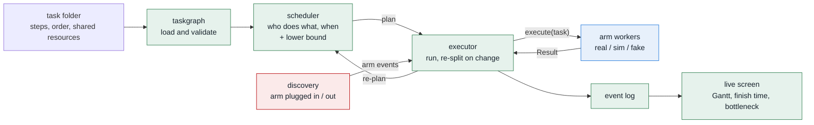

# Documentation

- [`plan.md`](plan.md): the main plan: teams, where teams meet, checkpoints, demo, safety.
- [`map.html`](map.html): one-page visual map (architecture, what happens when an arm is plugged in,
  speed-up limits, who builds what). GitHub shows it as source: download it and open it in a browser.
- [`../tasks/README.md`](../tasks/README.md): how to add a task.
- [`../research/`](../research/): background report and notes.

## How the parts connect

Colours: green Operations (#21), blue Action (#20), red Hardware (#19). Task folders are written by whoever
builds that task.

## When an arm is plugged in

1. Discovery sees a known arm and starts its worker.
2. The worker checks the arm's state and limits, moves slowly to home, and reports ready.
3. The executor keeps running tasks where they are and re-plans the rest.
4. The screen shows the new finish time and what now limits it (arm count, step order, or a shared resource).
