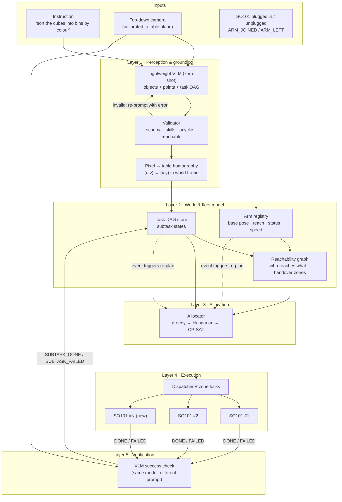
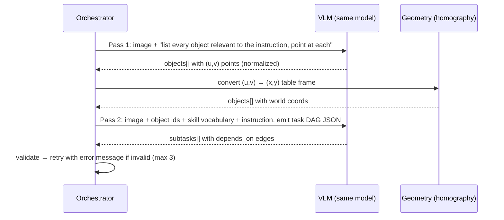
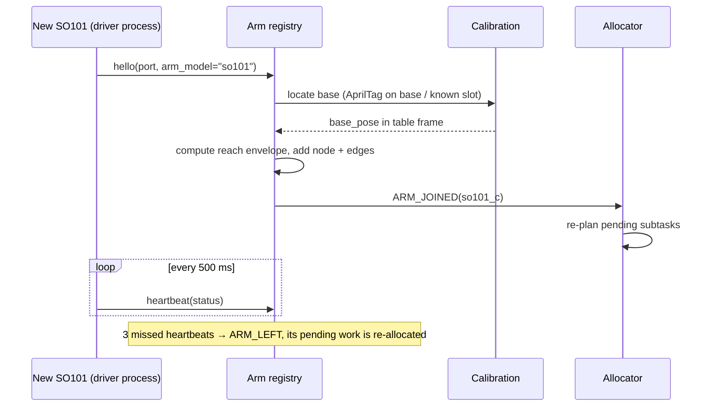
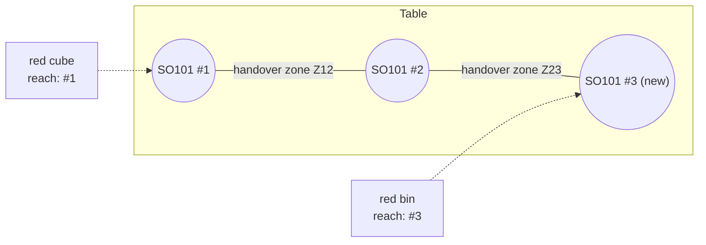
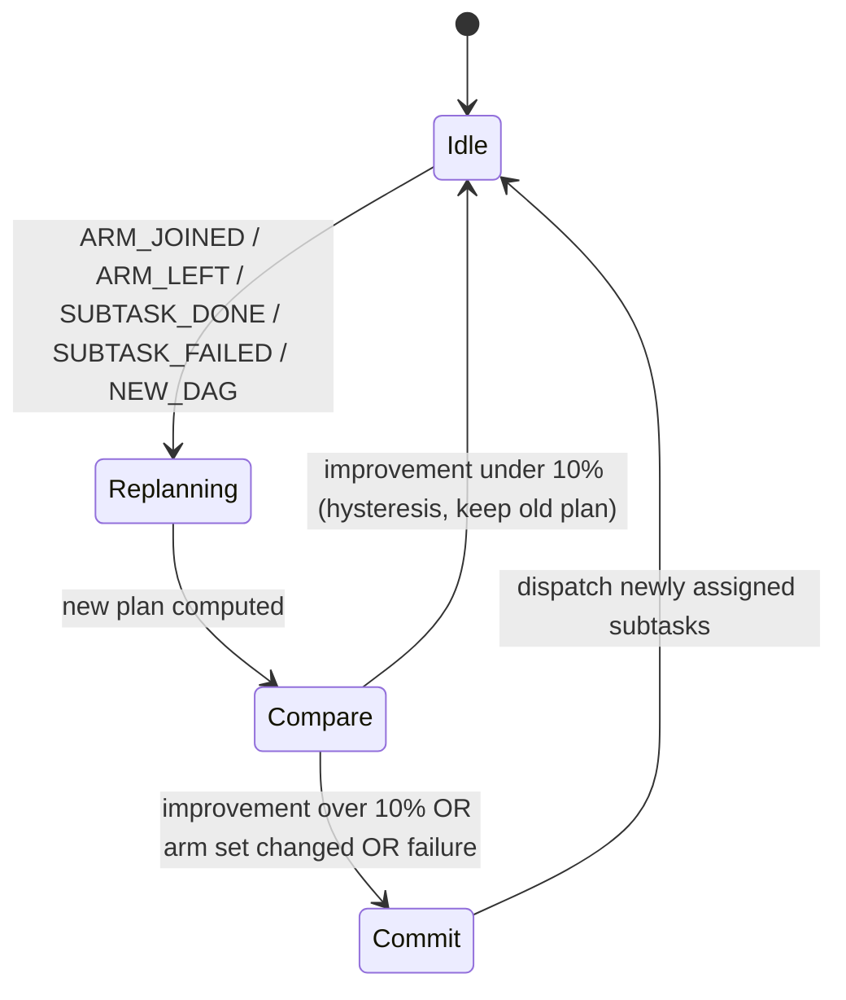
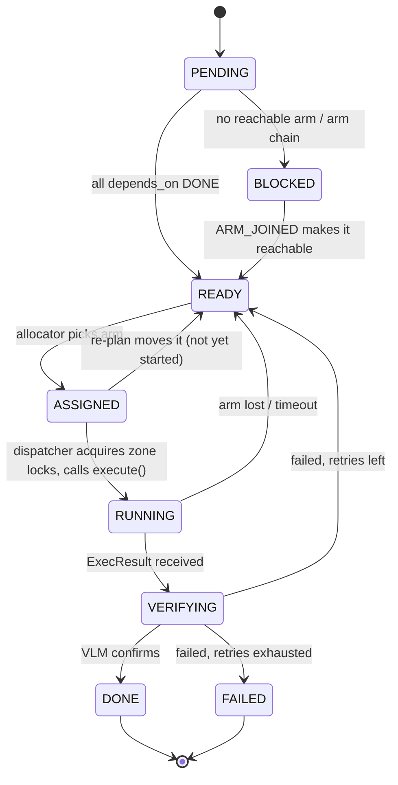
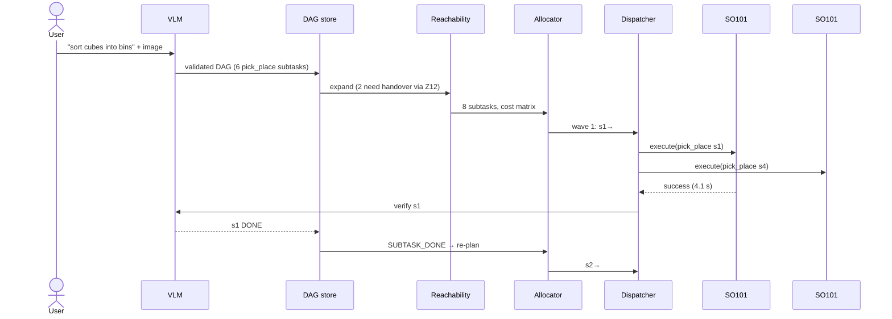
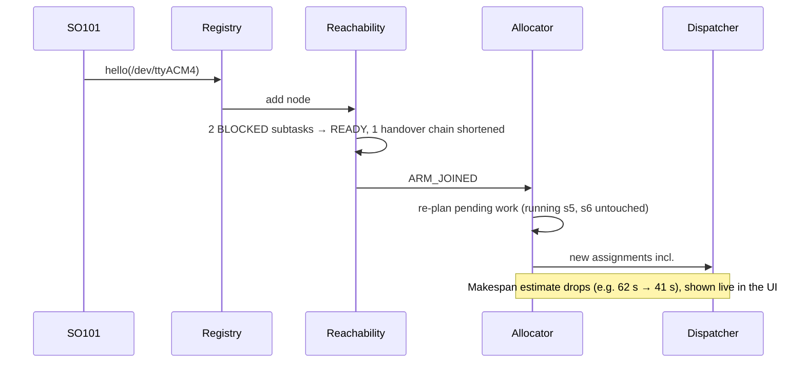
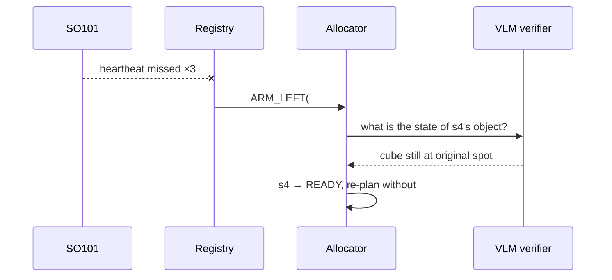

# Modular task allocation for a multi-SO101 cluster

> Owner: Aravind (`aravinds1610`) · Berlin Hackathon, Team A · Status: design v1 (2026-11-21)
>
> Scope: the layer that **decomposes a task and splits it across however many SO101 arms are connected**, and re-splits when arms are added or removed. Policies (ACT / SmolVLA / GR00T / π0.x) are out of scope; they sit behind a fixed `execute()` interface.

---

## TL;DR

- A **lightweight, off-the-shelf VLM** (no training, no fine-tuning) looks at a top-down camera image plus the instruction. It outputs a **task DAG**: *what* has to happen and in which order.
- The DAG is **arm-agnostic**. The VLM never decides *which arm* does what.
- A deterministic **allocator** maps DAG subtasks to the arms that are currently registered, using a **reachability graph** and a cost model.
- **Adding an SO101 = adding a node to the registry.** The allocator re-plans pending work. The VLM is not called again, and nothing is retrained.
- Arms report `DONE` / `FAILED` events back. The VLM can optionally verify success from the camera. Every event triggers a re-plan.

---

## 1. Design principles

| # | Principle | Why it matters |
|---|---|---|
| P1 | **Decompose once, allocate continuously** | VLM calls are slow (hundreds of ms to seconds). Allocation must be fast (milliseconds) because it reruns on every event. |
| P2 | **The DAG never mentions arms** | This is what makes the system modular. The plan stays valid for 2, 3 or N arms, so adding arms never invalidates it. |
| P3 | **The VLM perceives and reasons; code optimizes** | VLMs are good at scene understanding and bad at combinatorial optimization. Assignment and scheduling are solved exactly or greedily in code. |
| P4 | **No training anywhere in this layer** | Everything works zero-shot: prompting, constrained JSON decoding and geometry. Hackathon time goes to integration, not training runs. |
| P5 | **Policy-agnostic contract** | The whole layer talks to arms only through `execute(arm_id, skill, params)`. It can be developed and demoed with mock arms before any policy works. |
| P6 | **Never preempt running work** | Re-plans only touch *pending* subtasks. This avoids half-finished grasps and dropped objects. |
| P7 | **Fail safe, not fail silent** | Every VLM output is validated. Every subtask has a timeout. Every failure produces an event the allocator reacts to. |

---

## 2. System overview



**Reading the diagram.** There are two independent entry points:

1. **The left branch (instruction + camera)** runs rarely: once per task, or when the scene changes unexpectedly. It produces the DAG.
2. **The right branch (arm plugged in)** runs whenever the fleet changes. It only updates the registry and the reachability graph.

Both branches meet at the **allocator**, the only component that knows about both the work and the arms. Everything below the allocator is plain execution and feedback.

---

## 3. Layer 1: Perception and the VLM task decomposer

### 3.1 What the VLM is responsible for (and what it is not)

| The VLM does | The VLM does NOT |
|---|---|
| Identify task-relevant objects and targets in the image | Choose which arm does a subtask |
| Point at them (pixel coordinates) | Plan motions or joint angles |
| Break the instruction into subtasks from a fixed skill vocabulary | Estimate timings or optimize order for speed |
| Add dependency edges ("stack A before B on A") | Know how many arms exist |
| Later: judge whether a subtask visibly succeeded | Execute anything |

### 3.2 Model choice: lightweight and zero-shot

Requirements: open weights, runs locally on a laptop GPU (8 GB class) when quantized, supports **pointing/grounding** and **structured output** out of the box, with **no fine-tuning**.

| Candidate | Size | Why it fits | Watch out for |
|---|---|---|---|
| **Qwen3.5-4B** (default pick) | 4B dense, natively multimodal | Open (Apache 2.0). The model card reports it outperforms the Qwen3-VL models on visual understanding. Runs under ~5 GB at 4-bit. | Newer than Qwen3-VL, so there are fewer robotics prompt examples online |
| **Qwen3-VL-4B / 2B Instruct** | 4B / 2B | Native 2D grounding with **boxes and points in relative coordinates**. Strong cookbook examples for localization. | Slightly older generation |
| **Gemma 4 E4B** | ~4.5B effective | Model card lists **object detection, pointing and native function calling**. On-device oriented. | Different coordinate convention from Qwen; normalize in code |
| **Moondream 3 (preview)** | 9B MoE, ~2B active | Purpose-built for **detection, pointing and structured output** | Weaker at multi-step reasoning, so pair it with a text LLM for the DAG |
| **Molmo2-4B** | 4B | Built around pointing; open training data | Smaller ecosystem |
| **Gemini Robotics ER 2** (cloud fallback) | API | Purpose-built embodied reasoning, function calling, progress/moment detection | Needs internet and an API key; not local |

**Recommendation:** run **Qwen3.5-4B (or Qwen3-VL-4B) locally via vLLM or llama.cpp** as the single model for both decomposition and verification. Keep **Gemini Robotics ER 2** as the "if Wi-Fi is good" upgrade. The decomposer is behind an interface, so swapping models means changing one config line.

> All of these are used **as-is**. "No training" is achieved through (a) a tight prompt with a fixed skill vocabulary, (b) 1–2 in-context examples, (c) constrained JSON decoding, and (d) a validator with an automatic retry loop.

### 3.3 Two-pass prompting (more reliable on small models)

Small VLMs do better when grounding and reasoning are split:



- **Pass 1 (grounding):** "Point at every object relevant to the instruction." Output: object ids, labels and normalized points.
- **Pass 2 (reasoning):** "Given these object ids and these skills, produce the subtask DAG." The model only references ids, never coordinates. That reduces hallucinated geometry.

### 3.4 Fixed skill vocabulary

The VLM may only use skills the policy team has committed to. Example v1:

| Skill | Params | Arms needed |
|---|---|---|
| `pick_place` | `object`, `target` | 1 |
| `push` | `object`, `direction`, `distance_cm` | 1 |
| `handover` | `object`, `zone` | 2 (giver + taker) |
| `hold` | `object` | 1 |

**Important:** the VLM does **not** emit `handover`. Handovers are inserted later by the **reachability layer** when no single arm can reach both pick and place. That keeps the DAG arm-agnostic (principle P2).

### 3.5 Output schema (constrained decoding)

Enforce this with JSON-schema guided decoding (vLLM `guided_json`, llama.cpp grammars, or Outlines), so a small model physically cannot emit malformed output.

```json
{
  "objects": [
    {"id": "cube_red_1", "label": "red cube", "point": [0.412, 0.188]},
    {"id": "bin_red",    "label": "red bin",  "point": [0.850, 0.200]}
  ],
  "subtasks": [
    {"id": "s1", "skill": "pick_place", "object": "cube_red_1", "target": "bin_red", "depends_on": []},
    {"id": "s2", "skill": "pick_place", "object": "cube_blue_1", "target": "bin_blue", "depends_on": []},
    {"id": "s3", "skill": "pick_place", "object": "cube_green_1", "target": "cube_red_2", "depends_on": ["s1"]}
  ]
}
```

`point` is normalized `[u, v] ∈ [0,1]²`, and geometry converts it to world coordinates (next section).

### 3.6 Validation and retry

Every DAG passes these checks before it is accepted:

1. **Schema:** valid against the JSON schema
2. **Vocabulary:** every `skill` is in the allowed list
3. **References:** every `object` / `target` / `depends_on` id exists
4. **Acyclic:** topological sort succeeds
5. **Workspace:** every object point falls inside the table region
6. **Coverage (after the reachability layer):** every subtask is reachable by at least one arm or arm chain. Otherwise the subtask is marked `BLOCKED`, not silently dropped.

On failure, the error text is appended to the prompt ("subtask s3 references unknown object 'cube_purple'") and the VLM retries, up to 3 times. After that the orchestrator falls back to asking the operator.

### 3.7 Grounding: pixels to table coordinates

- A fixed **top-down global camera** looks at the table.
- At least **4 AprilTags / ArUco markers** at known table positions give a **homography H** from image pixels to table-plane `(x, y)` in metres.
- Objects on the table plane: `(x, y, 1)ᵀ ∝ H · (u·W, v·H_img, 1)ᵀ`. Depth is not needed because everything relevant lies on the plane (z = table height + object height / 2).
- The **same tags** (or one tag per arm base) give each SO101's **base pose in the table frame**. That is what the arm registry needs.

> Calibration is the single most important non-ML step. Without a shared frame, "which arm can reach this?" is meaningless.

### 3.8 When the VLM is called again

The VLM is **not** called when arms join or leave. It is called only when:

- a new instruction arrives
- the verifier detects an **unexpected scene change** (an object moved, fell or disappeared)
- validation fails (retry loop)

---

## 4. Layer 2: Arm registry and reachability graph

### 4.1 Arm registry

Each SO101 is an `ArmNode`:

| Field | Example | Source |
|---|---|---|
| `arm_id` | `so101_c` | assigned on join |
| `port` | `/dev/ttyACM2` | USB enumeration |
| `base_pose` | `(x=0.62, y=0.10, yaw=180°)` | AprilTag / mounting grid |
| `reach` | annulus `r_min..r_max` + yaw limits | measured once per arm model |
| `status` | `IDLE / BUSY / OFFLINE / FAULT` | heartbeat |
| `current_subtask` | `s2` or `null` | dispatcher |
| `skill_speed` | moving average of real durations | feedback events |
| `capabilities` | `{pick_place, push, handover}` | config (all SO101s are identical for now) |

**Join handshake:**



### 4.2 Reachability graph

Two kinds of reachability are computed:

1. **Point reachability:** for each arm `a` and world point `p`, `reachable(a, p)` is true if `p` lies inside `a`'s reach envelope (a radius check first; a fast IK check on the SO101 URDF for borderline points).
2. **Arm-to-arm adjacency:** arms `a` and `b` are connected if their reach envelopes **overlap** on the table. The overlap region is a **handover zone**.



**Subtask expansion.** For each DAG subtask `pick_place(obj, target)`:

- If some arm reaches **both** `obj` and `target`, keep it as one single-arm subtask.
- Otherwise, find the **shortest path** in the arm graph from an arm that reaches `obj` to an arm that reaches `target`. Expand the subtask into a chain: `pick_place(obj → Z12)` by #1, then `handover`/`pick_place(Z12 → Z23)` by #2, then `pick_place(Z23 → target)` by #3, with dependency edges between them.
- If no path exists, mark it `BLOCKED` and surface it in the UI. Adding an arm may unblock it, which is a great demo moment.

**Why this is the modular core.** When an arm joins, the graph gains a node and edges. Previously blocked subtasks may become reachable, long handover chains may shorten, and more subtasks can run in parallel. None of that requires touching the VLM or the DAG.

### 4.3 Cost model

For subtask `i` and arm `j`:

```
c_ij = t_reach(j, pick_i) + t_exec(skill_i, j) + t_reach(pick_i → place_i)
     + λ · load_j                 # spread work evenly
     + μ · zone_conflict(i, j)    # avoid crowding shared zones
     = ∞   if not reachable(j, pick_i) or not reachable(j, place_i)
```

- `t_*` are estimated from distance divided by the arm's measured `skill_speed`. The estimates improve as real durations come in.
- `λ` and `μ` are tuning knobs. Start with `λ = 0.5 s per queued subtask` and `μ = 2 s`.

---

## 5. Layer 3: Allocator

The allocator answers: **given the ready subtasks, the arms and the costs, who does what next?**

### 5.1 Algorithm ladder (build in this order)

| Level | Algorithm | Complexity | When to use |
|---|---|---|---|
| L1 | **Greedy online:** an idle arm takes its cheapest ready subtask | O(S·A) per event | Day 1. Always available as a fallback. |
| L2 | **Hungarian per wave:** optimal one-to-one matching of ready subtasks to idle arms (`scipy.optimize.linear_sum_assignment`) | O(n³), n ≈ 10 → microseconds | Default during runs |
| L3 | **CP-SAT makespan schedule** (OR-Tools): full plan with precedence, 2-arm subtasks and zone mutexes | NP-hard; solve with a time limit (e.g. 200 ms) | When time allows; compare against L2 in the demo |

### 5.2 CP-SAT formulation (L3)

- For each subtask `i` and capable arm `j`: an **optional interval** `I_ij` (start, duration `d_ij`, presence literal `x_ij`)
- `Σ_j x_ij = 1` (each subtask is done exactly once)
- `NoOverlap({I_ij : i})` for each arm `j` (an arm does one thing at a time)
- Precedence: `end(i) ≤ start(k)` for each DAG edge `i → k`
- Handover: the giver's and taker's intervals must **overlap in time**
- Zones: `NoOverlap` (or `Cumulative`, capacity 1) over intervals that use the same handover zone
- Objective: minimize the makespan `max_i end(i)`, plus a small load-balance term
- **Warm start** from the current greedy/Hungarian solution; if the solver hits the time limit, keep the best feasible solution so far

### 5.3 Re-planning policy



Rules:

- **Running subtasks are frozen** (P6). Only `PENDING` / `READY` subtasks can move.
- **Hysteresis:** switch plans only if the new one is meaningfully better (more than 10% makespan reduction), unless the arm set changed or something failed. This prevents thrashing.
- **Arm left mid-task:** its running subtask becomes `FAILED(arm_lost)`. The verifier checks the scene, the subtask is reset to `READY` (or the VLM re-plans if the object state is unclear), and the work is redistributed.

---

## 6. Layer 4: Dispatcher, execution interface, safety

### 6.1 The contract with the policy team

```python
class ArmExecutor(Protocol):
    def execute(self, arm_id: str, skill: str, params: dict) -> ExecResult: ...

@dataclass
class ExecResult:
    success: bool
    duration_s: float
    reason: str | None = None      # "grasp_failed", "timeout", "arm_lost", ...
```

- `params` carries **world coordinates** (or object ids plus coordinates). The policy layer decides how to use them, e.g. via a language prompt such as "pick the red cube" for a VLA, or via coordinates for a scripted skill.
- **MockExecutor:** sleeps `distance / speed + noise` and fails with probability `p` (e.g. 5%). The whole system is developed against this first.

### 6.2 Zone locks (cheap collision safety)

- Each handover zone and each "shared" region where envelopes overlap is a **mutex**.
- The dispatcher acquires the zone locks a subtask needs **before** dispatching it, and releases them on `DONE` / `FAILED`.
- The CP-SAT model encodes the same constraint, so plans are lock-feasible by construction. With greedy/Hungarian, a subtask whose zone is locked simply waits.
- This is deliberately conservative. Real inter-arm motion coordination (distributed MPC, null-space planning) is a later upgrade.

### 6.3 Timeouts and watchdog

- Each subtask gets a timeout of `3 × estimated duration`.
- A timeout produces `FAILED(timeout)`, the arm is put in `FAULT` until it reports healthy, and the work is re-allocated.

---

## 7. Layer 5: Verification and the feedback loop

The policy's own "I'm done" signal is not fully trusted. After each `ExecResult`:

1. Grab a fresh top-down frame.
2. Ask the **same VLM** a yes/no question with a constrained schema: *"Is `cube_red_1` inside `bin_red`? Answer `{"done": true|false, "confidence": 0..1}`"*.
3. Emit `SUBTASK_DONE` or `SUBTASK_FAILED(verification)`.
4. If the scene contradicts the DAG (an object vanished or moved), trigger a **VLM re-decomposition** of the *remaining* work.

### Subtask lifecycle



---

## 8. End-to-end walkthroughs

### 8.1 New task, 2 arms



### 8.2 A third arm is plugged in mid-run (the demo moment)



### 8.3 An arm fails



---

## 9. Suggested repository layout

```
allocation/
  core/
    models.py          # ArmNode, Subtask, Task DAG dataclasses
    events.py          # event bus: ARM_JOINED, SUBTASK_DONE, ...
    registry.py        # arm registry + heartbeat
    reachability.py    # point reachability, arm graph, handover expansion
    cost.py            # cost matrix
    allocator/
      greedy.py
      hungarian.py
      cpsat.py
    dispatcher.py      # zone locks, timeouts
  perception/
    calibration.py     # AprilTag homography, arm base poses
    vlm_client.py      # model-agnostic interface (local vLLM / llama.cpp / Gemini)
    prompts.py         # pass-1 grounding, pass-2 DAG, verification prompts
    schema.json        # constrained-decoding schema
    validator.py
  exec/
    executor.py        # ArmExecutor protocol
    mock_executor.py   # fake arms for development
  ui/
    sim2d.py           # top-down view, reach circles, Gantt chart, "+ add arm"
  tests/
```

---

## 10. Metrics for the demo

| Metric | What it shows |
|---|---|
| **Makespan vs number of arms** (2 → 3 → 4) | The headline: adding arms speeds things up automatically |
| **Re-plan latency** after `ARM_JOINED` | Modularity is cheap (target < 100 ms for L2) |
| **Blocked → unblocked subtasks** when an arm is added | Coverage grows with the fleet |
| **Arm utilization / idle time** | The work is split fairly |
| **VLM decomposition success rate** (valid DAG on first try) | Zero-shot VLM is good enough; retries cover the rest |
| **L1 vs L2 vs L3 makespan** | Value of smarter allocation |

---

## 11. Build order (hackathon timeline)

1. **Contract + mock executor:** agree on `execute()` with the policy team.
2. **Data model + event bus.**
3. **Reachability graph** with hard-coded arm poses.
4. **Greedy allocator + 2D sim UI** with an "add arm" button. *This alone is a demoable system.*
5. **Calibration:** AprilTags giving the homography and real arm base poses.
6. **VLM decomposer:** pass 1 and pass 2, schema, validator, retry loop.
7. **Hungarian allocator**, plus hysteresis and the re-plan policy.
8. **VLM verifier** in the feedback loop.
9. **CP-SAT** (stretch).
10. **Swap the mock executor for real policies** as they become available.

---

## 12. Risks and mitigations

| Risk | Mitigation |
|---|---|
| Small VLM hallucinates objects or points | Two-pass prompting, constrained decoding, validator, retry. Optional cross-check against a classic detector. |
| Calibration drift (camera or arm bumped) | Re-detect AprilTags every N seconds; flag a drift above 1 cm |
| Handover is the hardest skill for the policy team | Make handovers optional: if no handover skill exists, chains become `BLOCKED` and the demo focuses on parallelism |
| Re-plan thrashing | Hysteresis threshold; frozen running subtasks |
| Arms collide in overlapping regions | Zone mutexes (conservative). Keep overlaps small physically. |
| Wi-Fi down at the venue | Local quantized VLM is the default; the cloud model is optional |

---

## 13. References

- **OSDAG** (arXiv 2606.15255, 2026): the LLM is invoked once to produce a dependency DAG, and an online scheduler assigns ready tasks to idle robots. The direct inspiration for "decompose once, allocate continuously".
- **MA-VLA** (arXiv 2608.25864, 2026): VLM planner emits per-arm atomic prompts; tested on real dual SO101. Here the split happens one step earlier (arm-agnostic DAG).
- **RoboBallet** (Science Robotics, 2025): GNN + RL jointly doing allocation, scheduling and motion for up to 8 arms. Shows graph-based allocation scales with arm count.
- **VLA-Fabric** (arXiv 2610.23018, 2026): composable arm-local VLAs. A future direction for the policy side.
- **MART** (ICRA 2021): multi-arm tasks need coordination only at specific moments. Justifies independent subtasks plus occasional coupled handovers.
- **Ω-CBSA** (AAAI-26), **cuArms**, **MR-STORM** (2026): assignment-aware and distributed multi-arm motion planning. Future upgrades for the safety layer.
- **Qwen3-VL Technical Report** (arXiv 2511.21631); **Qwen3.5** small models (Mar 2026); **Gemma 4**; **Moondream 3**; **Molmo2**: lightweight VLM options.
- **Gemini Robotics ER 2** (Google DeepMind, Jul 2026): cloud embodied-reasoning option.
- Full landscape: `claude/multi-arm-policy-landscape.md` in the project docs.
